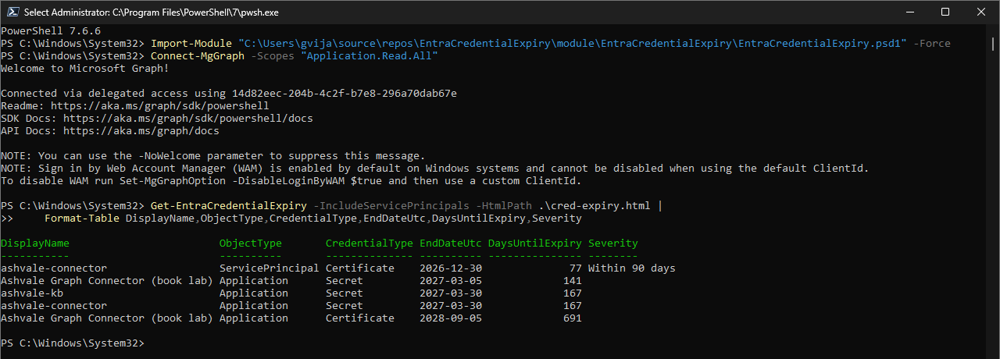
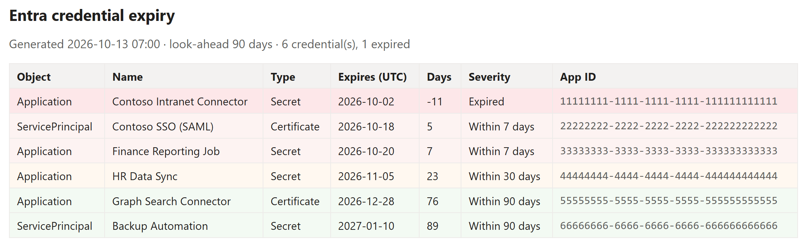

# EntraCredentialExpiry

Get a reminder **before** your Entra (Azure AD) app registration and enterprise application credentials expire.

Entra does **not** email you when a **client secret** is about to expire. SAML certificate expiry on enterprise apps sends notifications, so everyone assumes the same exists for client secrets. It does not. What you get instead is a *recommendation* tab ("Renew expiring application credentials") that only looks 30 days ahead, carries a Workload ID licence requirement, and sits there waiting for someone to remember to open it. A shared app registration with an expired secret does not fail politely: everything quietly depending on it stops at the same moment.

This module fixes that. It reads your app credentials directly from Microsoft Graph, on **your** expiry windows, and (optionally) **pushes** a Teams card or email so the reminder comes to you.

- **Read-only.** It only reads credential metadata and sends an alert. It never changes anything.
- **Covers both** app registrations *and* enterprise applications (service principals), secrets *and* certificates.
- **Your own windows** (default 90 / 60 / 30 / 7 days), not a fixed 30.
- **No licence requirement** (does not use the Workload ID recommendation).
- **Built to run unattended** on a schedule - Azure Automation, an Azure Function timer, a GitHub Action, or Task Scheduler.

## What it looks like

Run it from a console to see what is expiring, most urgent first:



Add `-HtmlPath` and it writes a styled report you can mail or keep - expired rows in red, then critical, warning, and healthy:



## Install

```powershell
Install-Module EntraCredentialExpiry -Scope CurrentUser
```

## Permissions and sign-in

Needs an app-only Microsoft Graph connection with **`Application.Read.All`** (add **`Mail.Send`** if you use email). Use a **managed identity** or a **certificate** - never a client secret, because that is the very thing that expires on you.

```powershell
Connect-MgGraph -Identity                                              # managed identity (Azure)
# or
Connect-MgGraph -TenantId <tenant> -ClientId <appId> -CertificateThumbprint <thumb>
```

## Use it on demand

```powershell
# everything expiring within your windows, most urgent first
Get-EntraCredentialExpiry -ExpiringOnly | Format-Table DisplayName,CredentialType,EndDateUtc,DaysUntilExpiry,Severity

# include enterprise apps, write a styled HTML report and a CSV
Get-EntraCredentialExpiry -IncludeServicePrincipals -HtmlPath .\cred-expiry.html -CsvPath .\cred-expiry.csv
```

## Run it unattended (the reminder)

You do not run this by hand every day. You schedule it **once** on a host that is always on, and it pushes an alert when something enters a window. The module is the logic; the host supplies the timer.

**GitHub Actions** (free, no Azure subscription needed): fork this repo and use the ready-made [`.github/workflows/scheduled-alert.yml`](.github/workflows/scheduled-alert.yml). It signs in with OIDC federation (no stored secret), runs daily, and posts to Teams/email. One-time setup steps are in the workflow file.

**Azure Automation** (if you run Azure): create a runbook with the account's managed identity, paste:
```powershell
Connect-MgGraph -Identity
Send-EntraCredentialExpiryAlert -TeamsWebhook $TeamsWebhook -IncludeServicePrincipals
```
then attach a daily Schedule.

**Azure Function (timer trigger)** or **Task Scheduler** work the same way: connect app-only, call `Send-EntraCredentialExpiryAlert`, let the host's timer fire it.

```powershell
Send-EntraCredentialExpiryAlert -TeamsWebhook $env:TEAMS_WEBHOOK -IncludeServicePrincipals
Send-EntraCredentialExpiryAlert -MailTo admin@contoso.com -MailFrom alerts@contoso.com
```

## Cmdlets

| Cmdlet | What it does |
|--------|--------------|
| `Get-EntraCredentialExpiry` | Lists credentials with expiry date, days remaining, and a severity bucket. `-IncludeServicePrincipals`, `-ExpiringOnly`, `-DaysWindow`, `-CsvPath`, `-HtmlPath`. |
| `Send-EntraCredentialExpiryAlert` | Runs the check for expiring items and sends a Teams Adaptive Card and/or an email. For scheduled, unattended runs. |

## Why not a web part or a hosted service?
Reading every app registration's credentials is a tenant-wide, app-only admin task, so a SharePoint web part (user-context) is the wrong surface. And a single hosted multi-tenant service would mean one person processing other organisations' credential data through their own infrastructure. A module keeps it **one shared, versioned codebase** that each admin runs against **their own** tenant, with their own auth - no code copies to maintain.

## License
MIT. See [LICENSE](LICENSE).

Author: **Vijay Kumar G** - [fivenumber.com](https://www.fivenumber.com)
